# Anar Ibadov — портфолио

Веб-разработчик из Азербайджана. Делаю сайты-визитки, лендинги и веб-сервисы, а также Telegram-ботов.
Работаю на русском и азербайджанском языках.

**Связаться:** [LinkedIn](https://www.linkedin.com/in/anar-ibadov/)

> Это витрина: здесь только описания и скриншоты. Исходный код проектов приватный и в открытом доступе не публикуется.
> Код и материалы можно показать по запросу в рамках обсуждения заказа.

---

## Alsat — сайт объявлений для Азербайджана

Бесплатная доска объявлений на азербайджанском и русском языках. Живой сайт: <https://alsat.anaris0909.workers.dev>

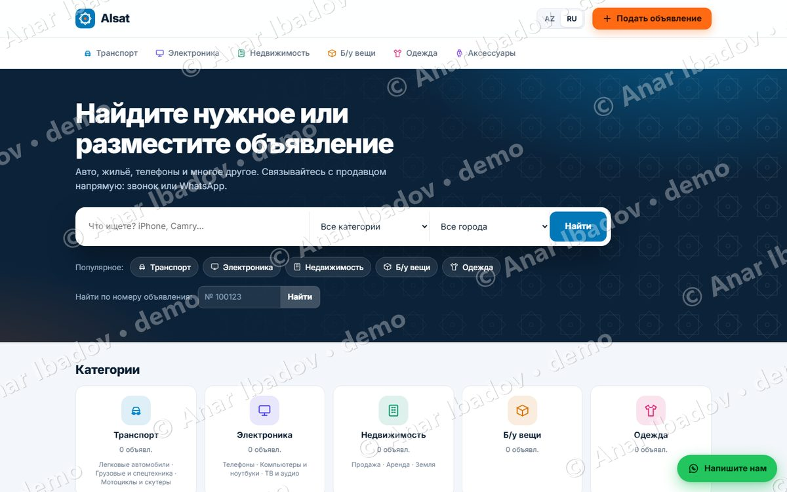

**Что умеет**
- Два уровня категорий (транспорт, электроника, недвижимость, б/у вещи, одежда, аксессуары); категории редактируются в админке.
- Подача объявления без регистрации, у каждого объявления свой номер, поиск по номеру, фильтры по городу и цене.
- Связь с продавцом по звонку или WhatsApp, номер объявления подставляется в сообщение автоматически.
- Редактирование объявления по номеру и PIN, жалобы, лимит объявлений в сутки, защита от ботов.
- Админка: модерация, фото, категории, страницы и статьи на двух языках.

**Стек:** TypeScript, Hono, Cloudflare Workers, Cloudflare D1 (SQL).

| Версия на азербайджанском | Мобильная версия |
|---|---|
| 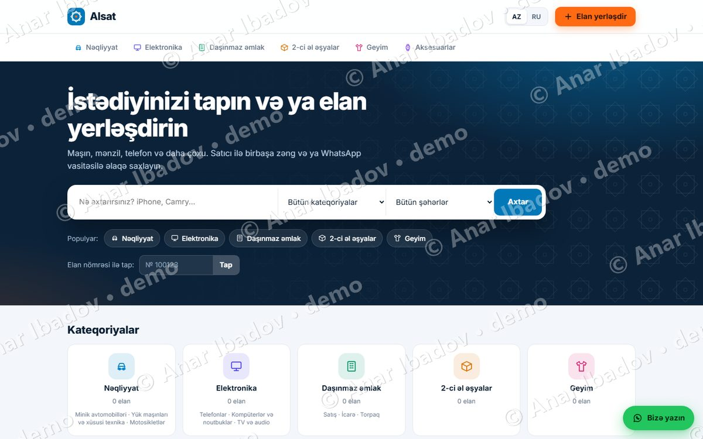 | 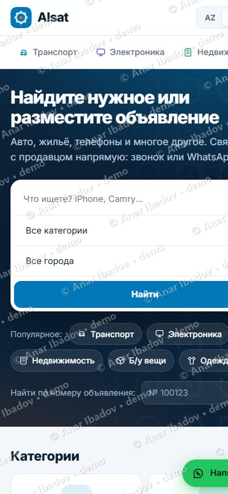 |

---

## Vertex — корпоративный сайт (демо-шаблон)

Собственный дизайн корпоративного сайта для бизнеса и услуг: HTML, CSS и JavaScript без библиотек и чужих файлов.
Это демонстрационный сайт: цифры и тексты на нём примерные, под клиента они заменяются.

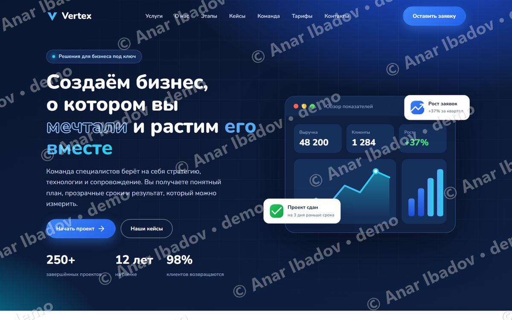

**Блоки:** главный экран со статистикой, услуги, о компании, этапы работы, кейсы, команда, тарифы, отзывы, вопросы и ответы, форма заявки.

**Стек:** HTML5, CSS3, JavaScript (без фреймворков), адаптивная вёрстка.

Страница целиком

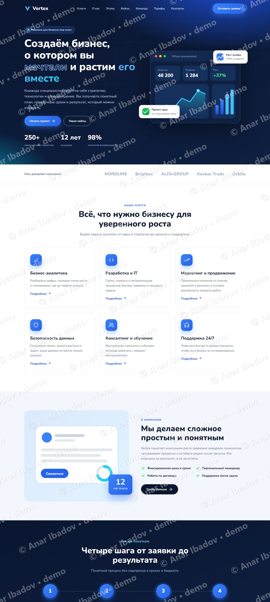

---

## R.R. Logistics — сайт международной логистической компании

Сайт компании, занимающейся международными грузоперевозками (Астара, Азербайджан). Живой сайт: <https://rr-logistics.org>

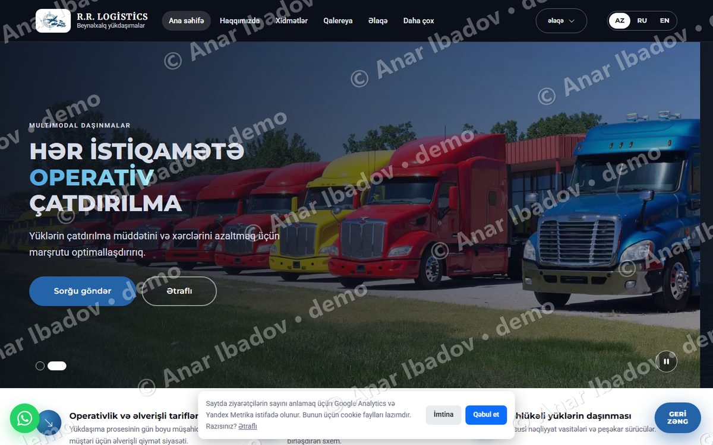

**Что сделано**
- Три языка интерфейса: азербайджанский, русский, английский.
- Страницы услуг, галерея, форма запроса стоимости: заявка уходит владельцу в Telegram.
- Кнопка WhatsApp, баннер согласия на cookie, карта сайта и мета-теги для поиска.
- Админка с входом по паролю для управления галереей.
- Быстрая загрузка: сайт собирается из статических страниц, скрипты и стили минифицируются при сборке.

**Стек:** HTML5, CSS3, JavaScript, Vercel (serverless-функция для заявок), Telegram Bot API.

| Русская версия | Мобильная версия |
|---|---|
| 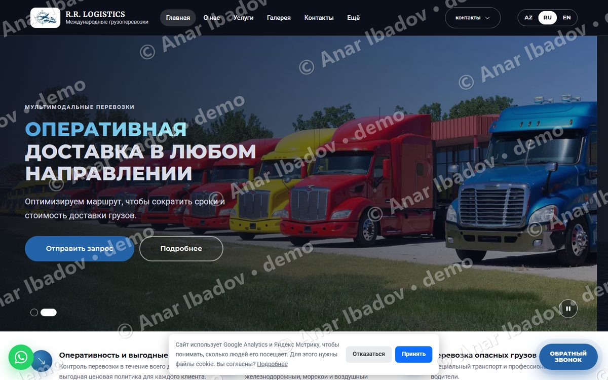 | 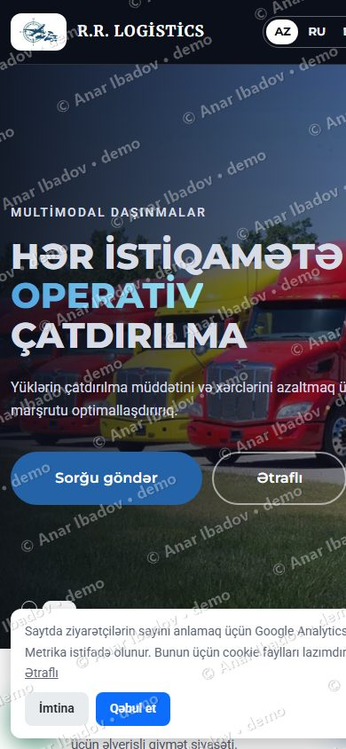 |

---

## FUNTIK Sushi & Pizza — интернет-магазин доставки еды (проект для клиента)

Интернет-магазин суши и пиццы для рынка Германии. Живой сайт: <https://funtik.store>
Это работа для клиента, исходный код принадлежит заказчику и здесь не публикуется.

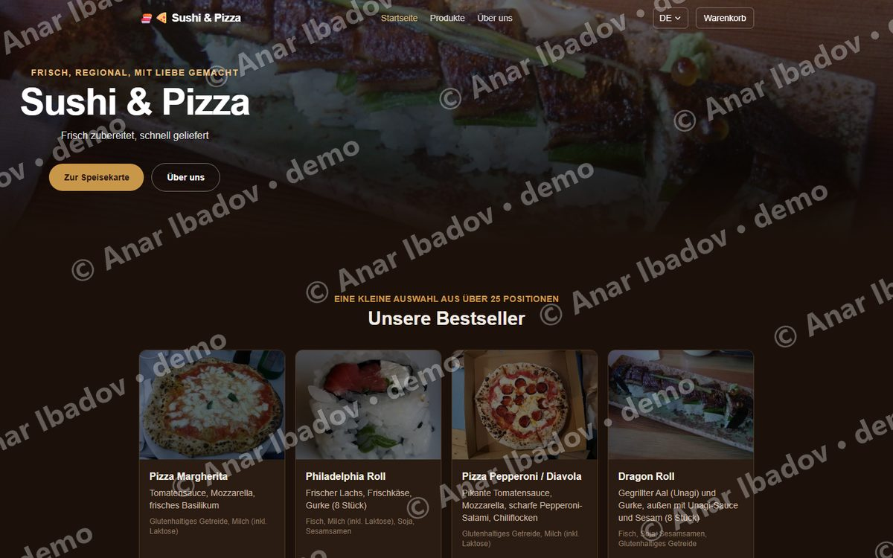

**Что сделано**
- Каталог с модификаторами (размер пиццы, добавки) и аллергенами по немецким требованиям.
- Корзина, оформление заказа с доставкой или самовывозом, расчёт по расстоянию.
- Оплата онлайн (карта, SEPA, PayPal) или наличными, чек в PDF после заказа.
- Четыре языка: немецкий, английский, русский и арабский (с написанием справа налево).
- Юридические страницы Impressum, Datenschutz, AGB.

**Стек:** Next.js (React), TypeScript, Tailwind CSS, Supabase (PostgreSQL), Stripe, next-intl.

| Русская версия | Мобильная версия |
|---|---|
| 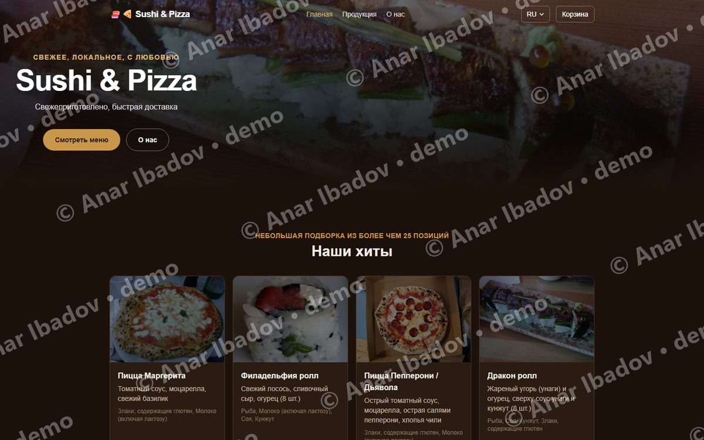 | 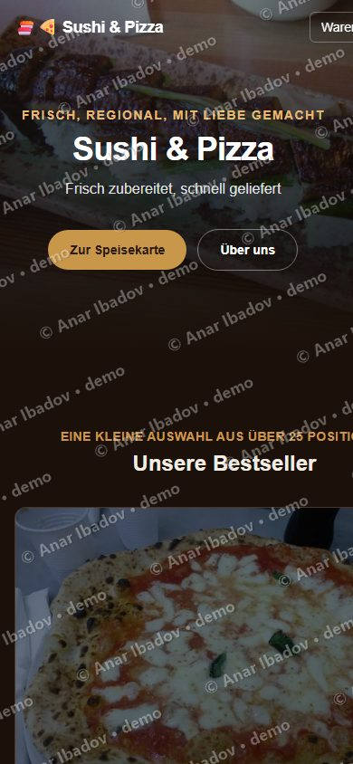 |

---

## Что могу сделать для вас

- Сайт-визитка или лендинг.
- Корпоративный сайт с формой заявки.
- Веб-сервис с базой данных и админкой.
- Telegram-бот для уведомлений и учёта заказов.

## Права

© 2026 Anar Ibadov. Все права защищены. Скриншоты и описания размещены только для ознакомления, копирование и повторное использование без письменного разрешения запрещены. Подробнее в файле [LICENSE](LICENSE).

---

# Anar Ibadov — portfolio (EN)

Web developer based in Azerbaijan: business websites, landing pages, web services and Telegram bots.
This repository is a showcase only (descriptions and watermarked screenshots). Source code is private and available on request.
Contact: [LinkedIn](https://www.linkedin.com/in/anar-ibadov/).
